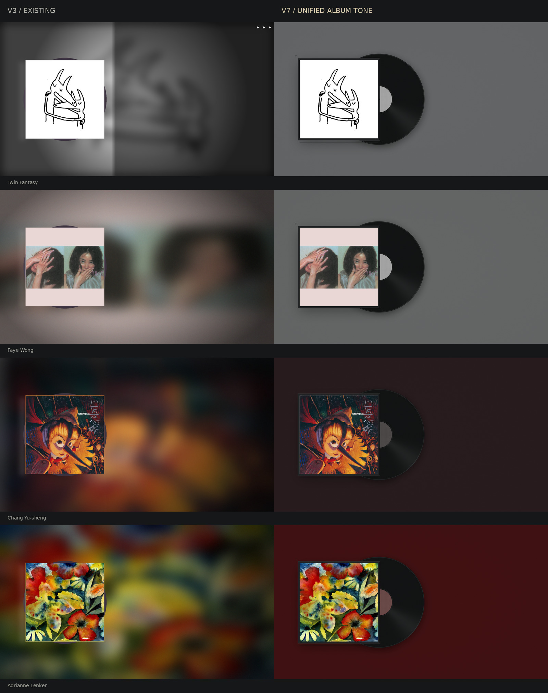

# V 项目 · 音乐视频背景工具箱

以专辑封面生成 1920×1080 背景，供音乐视频叠加标题、歌词等内容。

## V7 · 深夜唱片内封

2026-10-19 新增静态艺术版本：哑光封套、半露黑胶、细密沟槽、柔和投影和专辑配色环境光。整个背景统一使用专辑主色调，左右采用相同的亮度处理，只保留极轻的对称柔光与细颗粒；封面保持原色，右侧保留叠字空间。无预置标题、歌词或品牌文字。



左栏为已有 V3 文件，右栏为 V7。原 V3、V5、V6 均保留。

### 单张

```bash
cd /root/qclaw/tasks/v-project
python3 _gen_batch_bg_v7.py \
  --test 'cover_sources/input/21世纪独立摇滚/Car Seat Headrest - Twin Fantasy.jpg' \
  --output output/bg_v7/preview
```

### 按歌单批量

```bash
python3 _gen_batch_bg_v7.py \
  --input 'cover_sources/input/20世纪华语' \
  --output 'output/bg_v7/20世纪华语'
```

单张默认也写入 `output/bg_v7/`，不写入封面源目录。批量仅处理指定目录的图片，不递归子目录；文件名支持中文和空格。输出为 `bg_v7_序号_原文件名.png`。再次运行同一任务会更新对应 V7 输出，不改旧版本。

大量图片请后台生成并通过文件数确认进度：

```bash
nohup python3 -u _gen_batch_bg_v7.py \
  --input 'cover_sources/input/20世纪华语' \
  --output 'output/bg_v7/20世纪华语' \
  > /tmp/v-project-v7.log 2>&1 &
```

### 环境与验证

系统 Python 3、Pillow 和 NumPy，无新增依赖、网络请求或字体要求。

```bash
python3 -m unittest discover -s tests -p 'test_bg_v7.py' -v
```

像素哈希决定颗粒，跨进程和改名后保持一致（相同运行环境）。封面居中裁方，EXIF 方向先校正，透明封面合成到深灰底。封面在最终画面中占 x=180、y=265、550×550px。露出的唱片最右约 x=1056，叠字建议从 x=1120 起，右侧预留至少 100px 边距。视频标题、歌词应另行合成，不包含在背景 PNG 中。

## 其他版本

| 版本 | 脚本 | 产物 |
| --- | --- | --- |
| V3（内部注释称 V4 精致版） | `_gen_batch_bg_v3.py` | CD 装饰、模糊封面背景，PNG |
| V5 | `_gen_video_bg_v5.py` | 黑胶旋转、EQ 与唱针，MP4 / GIF |
| V6 | `_gen_video_bg_v6.py` | 暗金环境光、频谱残影与 CRT 颗粒，MP4 / GIF |
| V7 | `_gen_batch_bg_v7.py` | 深夜唱片内封，PNG |

V3 已有输出位于 `output/bg_v3/`。V7 样张位于 `output/bg_v7/preview/`。完整记录见 [VERSION_HISTORY.md](VERSION_HISTORY.md)。
